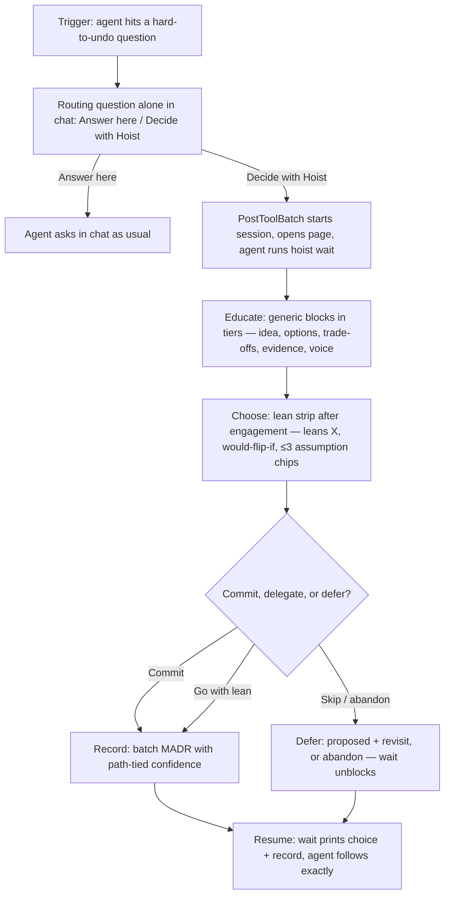
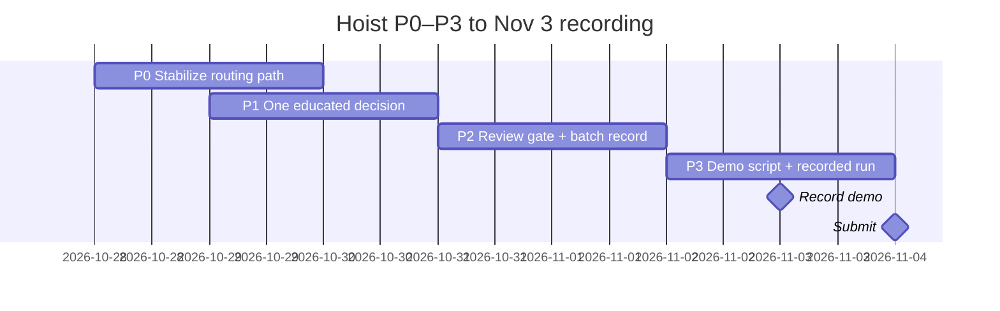

# Hoist build plan: educated decisions, not dice rolls

Goal: a Muse Code session where hard-to-undo questions become decisions the human
understands — teach the mechanism, ask about the human, then commit. Research
behind this plan: [questionnaire-research.md](questionnaire-research.md).

## The loop (what we're building)

## Schedule (now → recorded demo)

## Progress

Updated with every landed slice. Phases are shippable slices, smallest first.

- [x] Research: questionnaire mechanics + decision science + application model
- [x] **P0 — Stabilize routing path** (Oct 28–29): solo routing → PostToolBatch →
  session + wait, deterministic on a crafted prompt; logged hook payloads as
  regression fixtures. Scope around 3-option-full / multi-select gap.
  - [x] Offline replay: `test/test_routing.py` (22 checks) + PostToolBatch fixture
  - [x] Robustness fix: Recommended-suffix picks match, all answer shapes accepted
  - [x] Live owner re-run 10:21–10:23: solo routing, Hoist pick, wait, solo resume, 5 records
- [ ] **P1 — One educated decision** (Oct 29–30): one Compare page (mechanism,
  2 options with Bad-because, 1 tagged evidence link, 1 about-you question,
  lean strip with 1 flip + ≤3 chips). Demo beat: flip the decision by changing
  a chip.
  - [x] Draft contract: authored lean (why + ≤3 assumptions + ≤2 flips) + checks + 10 tests
  - [x] Sample: persistence-layer draft carries lean for click-through
  - [x] Course correction: session view rebuilt on the decision-moments engine (tabs, tiers, hyper dive, review) — stories wall deleted, record path untouched
  - [x] Loading wall gone: tabs render as drafts land; no more 30s dead screen
  - [ ] Owner click-through: tiers + lean strip + review + finish
- [ ] **P2 — Review gate + batch record** (Oct 31–Nov 1): landed early with the engine rebuild — decided tabs, escape row (delegate/park/back-to-chat, all unblock wait), gated review + finish, per-confirm MADR records.
  - [ ] Owner click-through covers P1 + P2 together
- [ ] **P3 — Demo + recording** (Nov 2–3): Muse-only single session, 3–5 minute
  arc (trigger → Compare → lean → chip-flip → commit → MADR in repo).

Explicitly out for Nov 3: other-agent ports, headless/ACP, mid-form abort,
multi-select routing, narration-tooling bake-off, pre-generated narration.
